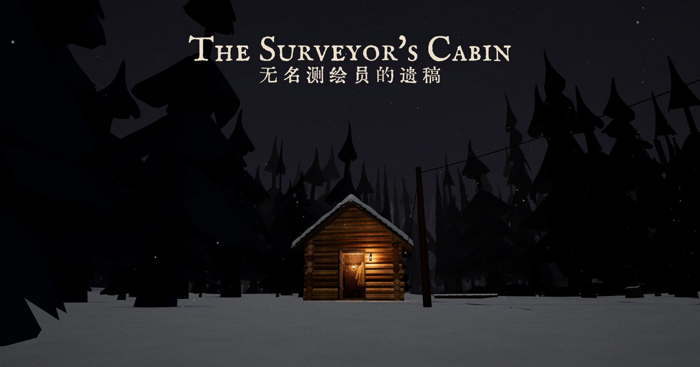

<div align="center">

# The Surveyor's Cabin

**On a desk in a cabin in the northern woods lies a page of inquiry notes. It is in your clerk's hand, and it describes what you have not done yet.**
Thirty years of spring reports from the Surveyor, then this year none. You are the old inspector sent to find out why. A short first-person mystery that plays in your browser.

Three days · about 20 minutes · four endings · English and Chinese, with voice-over

[**▶ Open it in your browser**](https://fxrcred.github.io/surveyors-cabin/) · [中文说明](README.zh.md) · three.js · no build step · code MIT

<a href="https://fxrcred.github.io/surveyors-cabin/"></a>

</div>

## How it goes

**Three days in the woods.** You are the old inspector who signed the Surveyor's commission thirty years ago. A young clerk who has read every report he sent comes with you.
- **Day one:** the door ajar, the porch lamp burning, the stove stone cold. Search the cabin for what he left behind.
- **Day two:** fog has come down, and something is out there for you to follow.
- **Day three:** walk to the end of it, and choose.
- Everything you find is written into the **Papers**, the *Nameless Surveyor's Last Papers*, in period English with the Chinese original underneath.

**How to play.** First person: WASD to walk, mouse to look, click to examine, E to take or climb. On a phone, tap where you want to go, or use *Rooms*. Progress is saved in the browser; close the page and come back later.

## The world around you

The cabin is a small simulated place that goes on whether or not you are looking. Sun, dusk and lamplight, weather, snow on the roof, chimney smoke on the wind; doors, lamps, the stove, the kettle and the rocking chair all work. There is a weather and time-of-day panel if you want to look around the cabin at other hours.

<table>
<tr>
<td></td>
<td></td>
</tr>
<tr>
<td></td>
<td></td>
</tr>
</table>

Works on desktop and phones (touch to orbit, fewer particles and trees on mobile). The page makes no requests to outside servers: three.js, decoders and fonts are all in the repo, so it also loads on networks where CDNs are blocked.

## Run it locally

Any static file server works. With Python:

```
git clone https://github.com/FxrcRed/surveyors-cabin.git
cd surveyors-cabin
python -m http.server 8765
```

Then open http://127.0.0.1:8765/. Opening `index.html` directly from disk won't work, since browsers block loading `.glb` models over `file://`.

## How it's made

- **The cabin** was modelled in Rhino with real furniture dimensions (about 3.5 × 3.5 m inside, one storey plus a loft) and exported to `cabin.glb` with Draco compression. The page groups meshes by Rhino layer name, which is how it knows which part is a door, a lamp or a lid.
- **The old man** is a Quaternius base character, dressed and animated in Blender (the clothes are built from the body mesh) and exported to `characters/man.glb`.
- **The clerk** wears a Quaternius outfit. Her reading, writing and ladder-climbing poses were set by script in Blender with IK, measured against the real furniture and ladder, and exported to `characters/woman.glb`.
- **Everything else is code** in a single `index.html` (three.js r169, ES modules, no bundler): the sky and sun, weather particles, the snow and puddle shaders, smoke, water, fire, the camera flights and the first-person controls. Collision and picking use [three-mesh-bvh](https://github.com/gkjohnson/three-mesh-bvh).
- **The story** was written in Chinese and translated into period English. Every clickable object has its own entry.

Built by vibe coding with Claude.

## Credits

| | Source | License |
|---|---|---|
| Trees | [Quaternius](https://quaternius.com/), via [poly.pizza](https://poly.pizza/) | CC0 |
| Characters and animations | Quaternius *Universal Base Characters*, *Modular Character Outfits – Fantasy*, *Universal Animation Library* 1 and 2 | CC0 |
| English font | IM Fell English by Igino Marini | SIL OFL 1.1 |
| Chinese font | [Huiwen Mincho Improved](https://github.com/bosswnx/huiwenmincho-improved) (subset) | CC0 |
| Sound effects, music, brook | [OpenGameArt](https://opengameart.org/); authors and links in [sfx/CREDITS.md](sfx/CREDITS.md) | CC0 |
| Ground texture | [ambientCG](https://ambientcg.com/) Ground 037; see [textures/README.md](textures/README.md) | CC0 |
| Voice-over | AI-synthesized with [Chatterbox](https://github.com/resemble-ai/chatterbox) (Resemble AI), voices cloned from [LibriVox](https://librivox.org/) readings by Peter Yearsley and Ruth Golding | MIT (Chatterbox); LibriVox recordings are public domain |
| Libraries | [three.js](https://threejs.org/), [three-mesh-bvh](https://github.com/gkjohnson/three-mesh-bvh), [Draco](https://github.com/google/draco) | MIT, MIT, Apache 2.0 |

The code is under the [MIT License](LICENSE). The cabin model, the story and the screenshots are © Fxrc, all rights reserved; please ask before reusing them.
