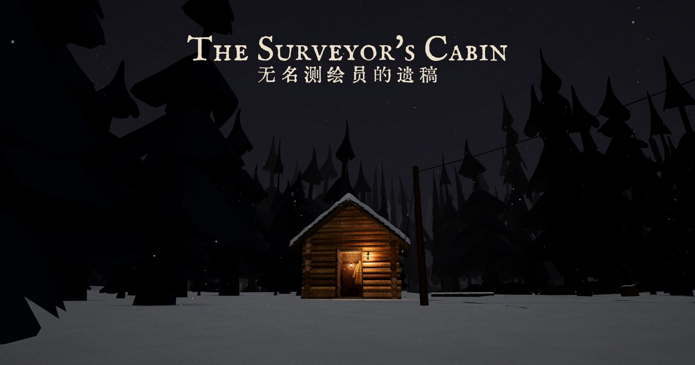

<div align="center">

# 无名测绘员的遗稿 · The Surveyor's Cabin

**北方森林里一座小屋的书桌上，压着一页调查记录。是你那位书记员的笔迹，写的是你们还没做的事。**
三十年来，林子里的测绘员每年开春寄回一份报告，今年没有来。你是被派来看看的老稽查。一个第一人称的悬疑短篇，在浏览器里打开就能玩。

三天 · 约 20 分钟 · 四个结局 · 中英双语，有配音

[**▶ 在浏览器里打开**](https://fxrcred.github.io/surveyors-cabin/) · [English](README.md) · three.js · 无需构建 · 代码 MIT

<a href="https://fxrcred.github.io/surveyors-cabin/"></a>

</div>

## 玩起来是这样

**林子里的三天。** 你是三十年前在他委任状上签字的老稽查，同行的是读过他每一份报告的年轻书记员。
- **第一天**：大门虚掩，门廊灯亮着，炉子冷透了。在屋里找他留下了什么。
- **第二天**：起雾了，林子里有东西等你跟上去。
- **第三天**：走到尽头，做一个选择。
- 找到的东西都记进 **遗稿**（《无名测绘员的遗稿》）：上面是老式英文，下面是中文原文。

**怎么玩。** 第一人称：WASD 走动，鼠标看，点一下细看，E 拿取、上下梯子。手机上点哪儿就走到哪儿，也可以用「房间」。进度存在浏览器里，关掉网页下次还能接着玩。

## 小屋周围的世界

小屋是一个小小的模拟场景，你不看它，它也在走。日光、黄昏和灯火，天气，屋顶积雪，烟囱的烟随风飘；门、灯、炉子、水壶、摇椅都能用。另有天气和时间面板，想看小屋在别的钟点什么样，可以自己调。

<table>
<tr>
<td></td>
<td></td>
</tr>
<tr>
<td></td>
<td></td>
</tr>
</table>

电脑和手机都能看（手机上单指转视角，粒子和树会少一些）。页面不请求任何外网：three.js、解码器、字体都在仓库里，国内网络也能正常打开。

## 本地运行

任何静态文件服务器都行，用 Python：

```
git clone https://github.com/FxrcRed/surveyors-cabin.git
cd surveyors-cabin
python -m http.server 8765
```

然后打开 http://127.0.0.1:8765/ 。直接双击 `index.html` 打不开：浏览器不允许从 `file://` 加载 `.glb` 模型。

## 怎么做的

- **小屋**在 Rhino 里建模，家具按真实尺寸（屋内约 3.5 × 3.5 米，一层加一个阁楼），用 Draco 压缩导出成 `cabin.glb`。网页按 Rhino 图层名分组，靠这个认出哪个是门、哪个是灯、哪个是盖子。
- **老人**用的是 Quaternius 的基础人物，在 Blender 里配衣服（用身体网格做）和动作，导出成 `characters/man.glb`。
- **女书记员**穿的是 Quaternius 的服装。看书、写字、爬梯子的姿势是在 Blender 里用脚本按真实家具和梯子尺寸用 IK 摆的，导出成 `characters/woman.glb`。
- **其余全是代码**，都在一个 `index.html` 里（three.js r169，ES 模块，不打包）：天空和太阳、雨雪粒子、积雪和水洼着色器、烟、水、火、镜头飞行和第一人称操控。碰撞和点选用 [three-mesh-bvh](https://github.com/gkjohnson/three-mesh-bvh)。
- **故事**先用中文写成，再译成老式英文，每件能点的东西都有一段。

和 Claude 一起 vibe coding 做的。

## 素材与许可

| | 来源 | 许可 |
|---|---|---|
| 树 | [Quaternius](https://quaternius.com/)，从 [poly.pizza](https://poly.pizza/) 下载 | CC0 |
| 人物和动作 | Quaternius *Universal Base Characters*、*Modular Character Outfits – Fantasy*、*Universal Animation Library* 1 和 2 | CC0 |
| 英文字体 | IM Fell English（Igino Marini） | SIL OFL 1.1 |
| 中文字体 | [汇文明朝体 改进版](https://github.com/bosswnx/huiwenmincho-improved)（子集） | CC0 |
| 音效、背景音乐、小溪 | [OpenGameArt](https://opengameart.org/)，作者和链接见 [sfx/CREDITS.md](sfx/CREDITS.md) | CC0 |
| 地面贴图 | [ambientCG](https://ambientcg.com/) Ground 037，见 [textures/README.md](textures/README.md) | CC0 |
| 配音 | 用 [Chatterbox](https://github.com/resemble-ai/chatterbox)（Resemble AI）AI 合成，音色克隆自 [LibriVox](https://librivox.org/) 上 Peter Yearsley、Ruth Golding 的朗读 | MIT（Chatterbox）；LibriVox 录音为公有领域 |
| 库 | [three.js](https://threejs.org/)、[three-mesh-bvh](https://github.com/gkjohnson/three-mesh-bvh)、[Draco](https://github.com/google/draco) | MIT、MIT、Apache 2.0 |

代码按 [MIT 许可](LICENSE) 开放。小屋模型、故事和截图 © Fxrc，保留所有权利，转载或使用请先联系。
